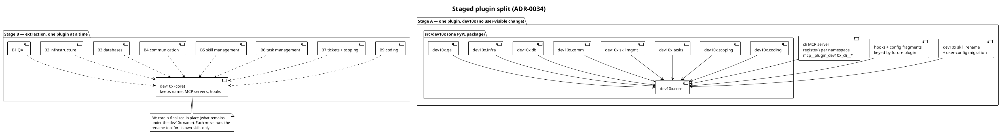

# 34. Staged plugin split: restructure in place, then extract one plugin at a time

Date: 2026-10-10

## Status

Accepted (2026-10-10). Supersedes
[ADR-0020](0020-core-plus-satellite-plugin-split.md), which was rejected
on 2026-08-04.

## Context

The supervisor wants the unified `dev10x` plugin (94 skills) split into
nine plugins by application area (GH-1522). ADR-0020 rejected a nearly
identical split two months ago, because a dependency scan found the
areas inseparable as a *single step*:

- the `work-on` closure spans about 32 skills;
- coding and tickets/scoping invoke each other;
- only four skills were cleanly severable.

This ADR keeps those findings and changes the sequencing, so that no
step ever depends on the split being finished.

### Current State

- One plugin, `dev10x`, with 94 skills, 2 MCP servers (`cli` with about
  90 tools, `db`), 12 hook entries across `hooks/hooks.json` and
  `hooks/hooks.d/*.json`, and one `src/dev10x` package.
- Shared configuration that mixes every area:
  - the permission catalog (`skills/upgrade-cleanup/projects.yaml`);
  - `skills/skill-index/families.yaml`;
  - `src/dev10x/core/validators/command-skill-map.yaml` (with
    fragments in `command-skill-map.d/`);
  - `hooks/hooks.json`.
- The `cli` MCP server runs scripts that live inside coding skill
  folders, such as `gh-context`, `gh-pr-*`, `git-*`, `release-notes`
  and `skill-index`.

### Problems

1. Per-area installation is impossible; every user gets 94 skills.
2. ADR-0020's blockers still apply to a one-shot split:
   - **invocation-name prefix:** `dev10x:<skill>` becomes
     `<plugin>:<skill>` when a skill moves, so every reference in skills,
     playbooks, docs, the command map and user configs must be rewritten;
   - **MCP tool-name prefix:** about 90 `mcp__plugin_dev10x_cli__*`
     names are hardcoded in 50+ skills and permission rules;
   - **hard cross-area `Skill()` edges.**
3. A split that is half-done must not leave users with a broken install.

### Prerequisites

- ADR-0006: the internal GitHub MCP server remains the sole GitHub
  surface.
- ADR-0010: uv-script skills are thin shims over importable modules,
  which makes namespace moves mechanical.
- ADR-0025: `projects.yaml` is the authoritative permission catalog,
  and this ADR fragments it.
- ADR-0028: deprecations carry a removal version, which governs the
  rename aliases and re-export shims.

## Decision

We will split in **two stages**.

1. **Stage A** restructures everything inside the single `dev10x`
   plugin with no user-visible change.
2. **Stage B** then extracts one plugin at a time, renaming only the
   skills that move in each step.

The core plugin **keeps the name `dev10x`**, both MCP servers, and the
core hooks in `hooks/hooks.json`. Each other plugin's hook entries live
in `hooks/hooks.d/<plugin>.json`, which the manifest lists under
`"hooks"` so Claude Code merges them into the default file (GH-1556).
That way no MCP tool is ever renamed.

### Architecture

### Target plugins

| Plugin | Plugin name | Skills |
|---|---|---|
| QA (6) | `dev10x-qa` | playwright, qa-self, qa-publish, review-pack, tts, yt-upload |
| infrastructure (2) | `dev10x-infra` | k8s, aws-vault |
| databases (3) | `dev10x-db` | db, db-psql, sql-handoff |
| communication (5) | `dev10x-comm` | bus, slack, slack-setup, gchat, gog |
| skill management (7) | `dev10x-teach` | skill-create, skill-audit, skill-audit-queue, audit-file, skill-index, context-audit, memory-maintenance |
| task management (7) | `dev10x-tasks` | session-tasks, session-wrap-up, plan-sync, park, park-discover, park-todo, park-remind |
| tickets + scoping (15) | `dev10x-scoping` | ticket-create, ticket-jtbd, jira, linear, scope, ticket-scope, project-scope, estimate, jtbd, ddd, spec-sync, spec-update, adr, adr-evaluate, project-audit |
| core (15) | `dev10x` | afk, ask, friction-setup, session-config-seed, upgrade-cleanup, plugin-maintenance, plugin-doctor, onboarding, permission-investigator, diag-friction, playbook, playbook-maintenance, gh-context (moved from coding in Stage A3, GH-1553), permission-audit-apply, skill-prune (GH-1631, GH-1627) |
| coding (37) | `dev10x-coding` | git and git-\* (10, including ticket-branch), gh-pr-\* / gh-review-setup (11), review, review-fix, request-review, slack-review-request, gchat-review-request, work-on, fanout, foreman, verify-acc-dod, py-test, py-test-flaky, py-uv, investigate, qa-scope, release-notes, ide-normalize |

### Plugin names and the invocation rule

The supervisor fixed the naming scheme on 2026-10-11 (GH-1580, recorded
on [GH-1522](https://github.com/Dev10x-Guru/Dev10x-Claude/issues/1522#issuecomment-6106516414)):

- Core keeps the manifest name `dev10x`. Each satellite is named
  `dev10x-<area>`, where `<area>` is its Python namespace key
  (`dev10x.<area>`).
- Claude Code always namespaces a plugin skill under the manifest
  `name`. Neither frontmatter `name` nor `displayName` changes that,
  and a plugin name cannot contain `:`. A satellite skill therefore can
  never be invoked as `dev10x:<skill>`.
- **Invocation rule:** extracting a skill moves its invocation name
  from `dev10x:<skill>` to `dev10x-<area>:<skill>`. The skill's own
  name does not change.
- MCP tool names do not change. Both servers stay in core, so every
  `mcp__plugin_dev10x_<server>__<tool>` name survives every extraction.
- `src/dev10x/core/plugins.yaml` records the namespace-key → plugin-name
  mapping under `plugin_names:`. `dev10x skill rename` and the Stage B
  steps read the target prefix from that file, not from this prose.

### Stage A: restructure in place

Every step ships inside `dev10x` and keeps:

- the plugin name;
- the `dev10x:` skill prefix;
- the MCP tool names;
- the observable behavior.

1. **Safeguards.** These land first:
   - a skill→plugin map with a test that assigns each of the 94 skills
     exactly once;
   - an import-boundary test, run in report-only mode;
   - a single resolver for skill-script paths used by `src/`;
   - a snapshot test of every registered MCP tool and its parameters;
   - an inventory of `dev10x:<skill>` references;
   - a typed reader for the `plan.yaml` mirror contract, owned by core.
2. **Python namespaces.** We move code into
   `dev10x.core|qa|infra|db|comm|teach|tasks|scoping|coding`.
   - Each step moves code and leaves a re-export shim at the old path.
     No logic changes.
   - The stage ends with the boundary test enforcing: a namespace
     imports only itself and `dev10x.core`, plus declared exceptions.
3. **MCP internals.**
   - Tool modules move to their owning namespace, and each namespace
     exports `register(server)`.
   - `misc_tools` is split by owner.
   - `pr_notify` stops importing the Slack module.
   - Server and tool names do not change.
4. **Config fragments.** Each piece of shared configuration becomes a
   set of fragments keyed by future plugin, all still loaded by
   `dev10x`:
   - the permission catalog;
   - `families.yaml` and `command-skill-map.yaml`;
   - `hooks.json`, split into `hooks/hooks.d/<plugin>.json`.

   The same step removes three cross-area edges:
   - `gh-context` leaves coding, so tickets no longer depend on it;
   - `park-remind` calls the `dev10x skill notify` CLI instead of a
     path into the slack skill;
   - the default playbook splits into a mechanism (core) and the
     `work-on` plays (coding).
5. **Rename machinery.**
   - A `dev10x skill rename <old> <new>` command rewrites one skill's
     invocation name across the repo, with a dry-run diff.
   - upgrade-cleanup gains a migration that rewrites old names in user
     configs (`friction.yaml`, playbook overrides, DoD criteria).
   - The old name stays readable as an alias for one release
     (ADR-0028).
   - The tool is rehearsed inside `dev10x` before Stage B.

### Stage B: extract one plugin at a time

Each extraction is a short PR series:

1. scaffold `plugins/
/` with a manifest;
2. `git mv` the plugin's skills and its config fragments;
3. run `dev10x skill rename` for those skills only;
4. add a marketplace entry and the user-config migration;
5. release.

Order, set by the supervisor:

| Step | Plugin | Notes |
|---|---|---|
| B1 | QA | Depends on core MCP tools only. `review-pack → request-review` becomes a declared QA→coding edge. |
| B2 | infrastructure | No edges into the rest (`k8s` uses the `aws-vault` script, now inside one plugin). |
| B3 | databases | The `db` MCP server stays in core, so tool names are preserved. |
| B4 | communication | Edges were removed in Stage A (`pr_notify`, park-remind). |
| B5 | skill management | The skill index and `families.yaml` were fragmented in Stage A. |
| B6 | task management | The `plan.yaml` contract and the hook fragment came from Stage A. |
| B7 | tickets + scoping | Coding↔scoping stays a declared mutual dependency. |
| B8 | core | Finalized in place under the `dev10x` name. Only the core's own skills remain, plus coding until B9. |
| B9 | coding | Leaves last as its own plugin. Its skills, hook fragment and config fragments move, but its MCP tool modules stay registered by core's `cli` server (see [Stage B decisions](#stage-b-decisions)). |

### Key rules

1. **Every PR leaves a releasable `dev10x`.** No step depends on a
   later one to restore behavior.
2. **Core keeps its name forever.** That gives zero MCP tool renames
   and zero permission-rule rewrites for tools.
3. **Satellites depend on core.** Each satellite manifest declares
   `"dependencies": ["dev10x"]`. The Claude Code manifest reference
   documents the field (`"name"`, `"name@marketplace"`, or
   `{name, marketplace, version}`), and a plugin that an enabled plugin
   depends on starts enabled. A `plugin-doctor` check stays only as a
   belt-and-braces guard. The declaration form is bare names generated
   from `plugins.yaml` (GH-1561, see
   [Stage B decisions](#stage-b-decisions)).
4. **One PyPI package, `dev10x`.** All plugins import from it, which
   avoids duplicating the safety-hook chain.

### Plugin dependencies

The install chain is **coding → tasks → core** (GH-1556). Coding's
`work-on` keeps a terminal task open through the tasks plugin's
`task-guard`, so coding cannot install without tasks, and every plugin
needs core.

`src/dev10x/core/plugins.yaml` records this as data:

- `dependencies` lists hard install dependencies by namespace key
  (`coding: [tasks]`). Core is implicit for every plugin and declares
  none. A test requires known keys and an acyclic graph; Stage B turns
  each entry into the manifest `dependencies` field (Key rule 3).
- `soft_dependencies` lists the mutual `Skill()` edges that degrade
  when the other plugin is absent: coding↔scoping and QA→coding
  (`review-pack → request-review`). These are not install
  requirements, may form cycles, and are only checked for known keys.
- `extracted` lists the keys already shipped as their own plugin. A key
  not listed there still ships inside `dev10x`, so
  `dev10x.core.plugin_enablement` resolves it to the core install id
  (`dev10x@Dev10x-Guru`); an extracted key resolves to
  `dev10x-<key>@<marketplace>`.

### Hooks per plugin

Hooks follow the same split. `hooks/hooks.json` keeps the core entries
(session start/stop, skill pre/post, the Bash/Monitor validator chain,
the Edit/Write validator, pre-compact, permission-denied).
`hooks/hooks.d/tasks.json` holds `task-guard` and `task-plan-sync`, and
`hooks/hooks.d/coding.json` holds `ruff-format`. Claude Code runs
matching hooks from all files in parallel, in no defined order, so no
entry may depend on another running first.

`task-guard` belongs to tasks (resolving open decision 2). It guards a
plan whose context sets `guard_terminal_task`, the generic opt-in any
orchestrator can write. Coding's `work_on`/`routing_table` context
keys trigger it only while the coding plugin is enabled, read from the
`enabledPlugins` settings (local over project over user), and an
unreadable settings file counts as enabled.

### Config fragments per plugin

The permission catalog, `families.yaml` and `command-skill-map.yaml`
split in Stage A3 (GH-1589, GH-1590). Each base file keeps core's part,
and `<name>.d/<plugin>.yaml` holds each plugin's. Readers merge core
first, then the fragments in `plugins.yaml` order.

The supervisor accepted the reorder this causes:

- `ensure-base` appends catalog rules in the merged order, not the
  one-file order. A test pins that every list keeps the same multiset
  of rules, with no duplicates.
- `SKILLS.md` lists families in plugin order (Setup, QA, Data, Meta,
  Session, Scoping, then the coding families).
- DX006's first-match-wins can pick a different rule when several rules
  match one command. Tests pin the winners that changed.

Ownership rules:

1. **MCP allows** belong to the plugin whose skills declare the tool in
   `allowed-tools`. A tool declared by skills of several plugins, or by
   none, stays in core. A test recomputes each owner from the skill
   front matter and `plugins.yaml`, with a short override list (the
   `db` server's `query` belongs to db).
2. **`Bash(gh …)` and `Bash(git …)`** allows, the git aliases, the
   test/lint runners and the foreman CLI spellings belong to coding.
   Generic shell, `/tmp`, data tools, docs domains, `Skill(dev10x:*)`
   and the `dev10x` CLI stay in core.
3. **The safety floor stays in core:** `base_asks`, `base_denies`,
   `tracker_denies` and the IDE blocks. A deny must hold in every
   install, whichever plugins it has.
4. **Families stay whole.** Each family lives in exactly one fragment,
   and every skill in it belongs to that fragment's plugin. Shipped
   families name only Dev10x skills.
5. **DX006 rules** belong to the plugin of their first skill
   compensation, or to the owner of the tool they steer to. Generic
   shell-shape rules stay in core. `ci-loop-handrolled` stays in core
   on purpose: a CI poll loop must reach it before
   `watch-loop-handrolled` and before any plugin's rules. The `gh` CLI
   rules stay together in coding even where their wrapper is used more
   widely.

The hook skips an exempted match (a safe push, a backgrounded watch
loop) and keeps evaluating, so the reorder cannot let a loop body
through unchecked (GH-1590).

## Alternatives Considered

### Alternative 1: Keep the unified plugin (ADR-0020's outcome)

**Pros:**
- No migration cost.

**Cons:**
- No per-area installation. The catalog and the namespace keep growing.

**Verdict:** Rejected. The supervisor wants per-area plugins, and
Stage A removes the risk that made ADR-0020 reject the split.

### Alternative 2: ADR-0020 core-plus-satellites in one pass

**Pros:**
- Fewer steps.

**Cons:**
- Every area move combines a code move, a config split and a rename
  in one PR, so a single mistake breaks installs.
- This is the exact risk profile that was rejected.

**Verdict:** Rejected.

### Alternative 3: Fully symmetric split (server and package per plugin)

**Pros:**
- Self-contained plugins.

**Cons:**
- Renames about 90 MCP tools and fractures the hook chain.

**Verdict:** Rejected. This repeats ADR-0020's Alternative 2.

### Alternative 4: Staged — restructure in place, then extract (selected)

**Pros:**
- Each PR is small and mechanical: a move plus a shim, or a fragment.
- Renames happen per plugin, through a tested tool and a user
  migration.
- MCP tool names never change.

**Cons:**
- About 40 PRs.
- Re-export shims live until the end of Stage B.
- Coding↔scoping and QA→coding stay as declared cross-plugin
  dependencies.

**Verdict:** Selected.

## Consequences

### What Becomes Easier

1. Per-area installation, with smaller skill catalogs per session.
2. Clear ownership: every module, config fragment and skill belongs to
   one plugin, and a test enforces it.
3. Each extraction can be reviewed in isolation.

### What Becomes More Difficult

1. The repo layout and release tooling must handle many plugins.
2. Invocation names change once per moved skill, so users must run
   upgrade-cleanup.
3. Re-export shims add temporary indirection until they are removed
   after B9.

### Risks and Mitigations

| Risk | Likelihood | Impact | Mitigation |
|------|------------|--------|------------|
| A missed `dev10x:<skill>` reference after a move | Medium | Medium | The reference inventory test from Stage A, plus the rename tool's dry-run diff in each move PR |
| A satellite is installed without core | Medium | High | The manifest `dependencies` declaration generated from `plugins.yaml` (Key rule 3, GH-1561), backed by a `plugin-doctor` check and install docs |
| B9: coding tools must register in a server shipped by core | Low | High | Core's `cli` server keeps registering `dev10x.coding` tools unconditionally; only skills and fragments move (GH-1563). Core-only installs list the coding tools |
| User configs reference old names | High | Low | The upgrade-cleanup migration, plus a one-release alias (ADR-0028) |
| Long-lived shims drift | Medium | Low | The boundary test enforces new paths, and the shims are removed in one PR after B9 |

## Implementation Plan

GH-1522 tracks the plan. Milestones and step issues follow this ADR's
stages.

### Stage A

1. **A0 Safeguards:** the skill→plugin map and its test, the boundary
   test (report-only), the script-path resolver (`src/dev10x/core/paths.py`),
   the MCP snapshot test, the reference inventory test, and the
   `plan.yaml` contract reader.
2. **A1 Namespaces:** move plus shim, one namespace or sub-area per PR,
   in the order `core` → `tasks` → `comm` → `db` → `teach` →
   `scoping` → `coding` → `qa`/`infra`. Then switch the boundary test to
   enforcing.
3. **A2 MCP internals:** split `misc_tools`, add `register(server)` per
   namespace, and decouple `pr_notify`.
4. **A3 Config fragments:** the permission catalog, `families.yaml`,
   `command-skill-map.yaml` and `hooks.json`; also `gh-context`,
   `park-remind`, and the default playbook split.
5. **A4 Rename machinery:** `dev10x skill rename`, the upgrade-cleanup
   migration, and a rehearsal.

### Stage B

B1 QA → B2 infrastructure → B3 databases → B4 communication → B5 skill
management → B6 task management → B7 tickets + scoping → B8 core →
B9 coding. Each step is one PR series that ends in a release.

### Stage B decisions

The supervisor decided the Stage B open decisions on 2026-10-19
(milestone 76, tracker GH-1522).

1. **`qa-scope` stays in coding (GH-1562).** Its only automated caller
   is `gh-pr-monitor` Phase 2.5, which already invokes it "if
   available". Moving it would add a soft coding→QA edge, and coding
   installs without `dev10x-qa` would silently lose QA triage. It
   analyses a diff and files tickets, with no browser. B1 therefore
   moves the six QA skills already listed in `plugins.yaml`, and no new
   dependency edge is added.
2. **Satellites use the native manifest `dependencies` field
   (GH-1561).** Claude Code documents it in the manifest reference;
   bare names resolve within the plugin's own marketplace, and a
   dependency of an enabled plugin starts enabled.
   - `plugins.yaml` stays the source of truth: hard `dependencies` with
     core implicit for every key, checked for known keys and
     acyclicity.
   - Each satellite manifest gets `["dev10x", …]` plus its hard
     dependencies mapped through `plugin_names`, e.g. coding declares
     `["dev10x", "dev10x-tasks"]`.
   - `soft_dependencies` are never emitted to a manifest; they describe
     edges that degrade, not install requirements.
   - A test asserts each manifest equals what `plugins.yaml` derives.
   - A `plugin-doctor` check and install docs remain as a backup.
   - Version constraints and auto-install behaviour are not yet
     verified; B1 confirms both before relying on them. Version
     lockstep through the object form is deferred until then.
3. **B9 runs, and coding's MCP tools stay in core (GH-1563).** Tools
   follow the server; skills follow the plugin.
   - `server_cli.py` registers the `coding` namespace from the single
     `dev10x` package, so the server can always load those tools.
   - Registering them only when the coding plugin is enabled is not
     reliable. The optional shared MCP daemon (GH-338) serves several
     projects with one tool list fixed at startup, while plugin
     enablement is per project.
   - B9 moves coding's skills, hook fragment and config fragments to
     `dev10x-coding`. No `mcp__plugin_dev10x_cli__*` name changes.
   - Core-only installs list the git and GitHub tools without the
     skills that drive them. Gated registration is revisited only if
     tool-list size becomes a measured problem.
4. **Config fragments stay in core's tree (GH-1564).** Stage B step 2
   says to `git mv` a plugin's config fragments too. B1 does not.
   - Every reader of a fragment (`command-skill-map.d/`,
     `families.d/`, `projects.d/`) runs from core's package and globs
     core's own directories, so a fragment moved under `plugins/
/`
     would stop loading.
   - The fragments load whether or not their plugin is enabled. For
     QA that is harmless: its DX006 rules are advisory
     (`hook_block: false`), and a family or allow rule naming a skill
     that is not installed matches nothing.
   - Moving them waits for readers that search each enabled
     satellite's root, gated on `plugin_enablement`. Until then a
     fragment records its owner by file name only.
5. **Old names stay readable until `0.114.0` (GH-1564).** Each moved
   skill gets one `SKILL_NAME_ALIASES` row, and
   `dev10x config migrate-skill-names` rewrites user configs.

### Open decisions (record before the dependent step)

1. ~~How satellites declare their dependency on core~~ — decided
   (GH-1561): see [Stage B decisions](#stage-b-decisions).
2. ~~Where `task-guard` lives~~ — decided (GH-1556): task management,
   with coding's rules gated on the coding plugin being enabled (see
   [Hooks per plugin](#hooks-per-plugin)).
3. ~~Where `qa-scope` lives~~ — decided (GH-1562): coding.
4. ~~Whether B9 runs~~ — decided (GH-1563): it runs, with coding's MCP
   tools kept in core.

## References

### Internal References

- [ADR-0020: core-plus-satellite plugin split (rejected)](0020-core-plus-satellite-plugin-split.md)
- [ADR-0010: uv-script skills as importable modules](0010-uv-script-skills-as-importable-modules.md)
- [ADR-0025: projects.yaml is the authoritative permission catalog](0025-projects-yaml-is-the-authoritative-permission-catalog.md)
- [ADR-0028: deprecations carry a removal version](0028-deprecations-carry-a-removal-version.md)
- [GH-1522: decision ticket](https://github.com/Dev10x-Guru/Dev10x-Claude/issues/1522)
- [GH-913: original split request](https://github.com/Dev10x-Guru/Dev10x-Claude/issues/913)

### External Documentation

- [Claude Code plugin marketplaces](https://code.claude.com/docs/en/plugin-marketplaces)
- [Claude Code plugin manifest reference](https://code.claude.com/docs/en/plugins/manifest-reference):
  the `name` namespace and the `dependencies` field
- [Claude Code skills](https://code.claude.com/docs/en/skills): skill
  invocation names are prefixed with the plugin name
