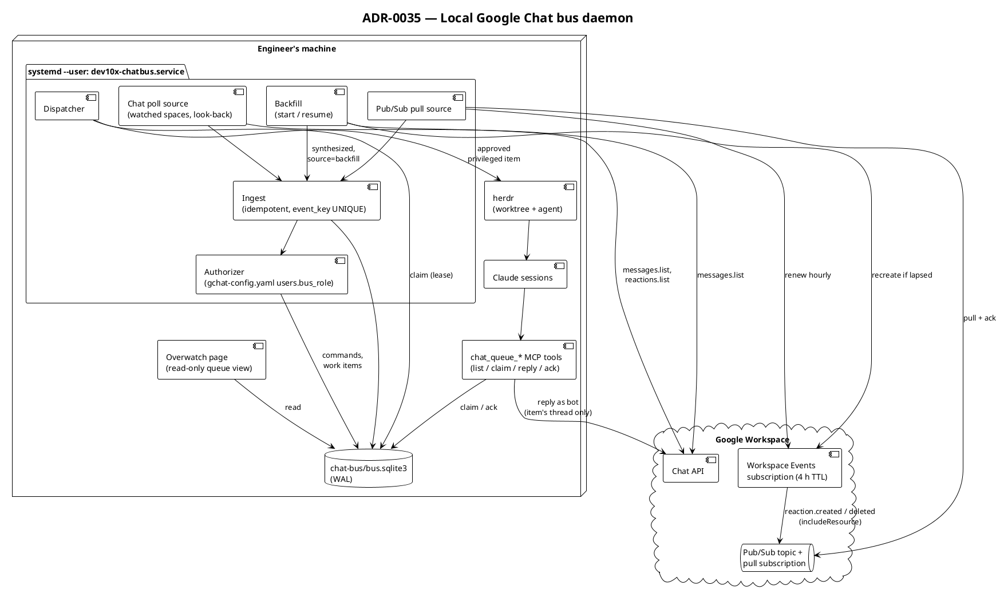
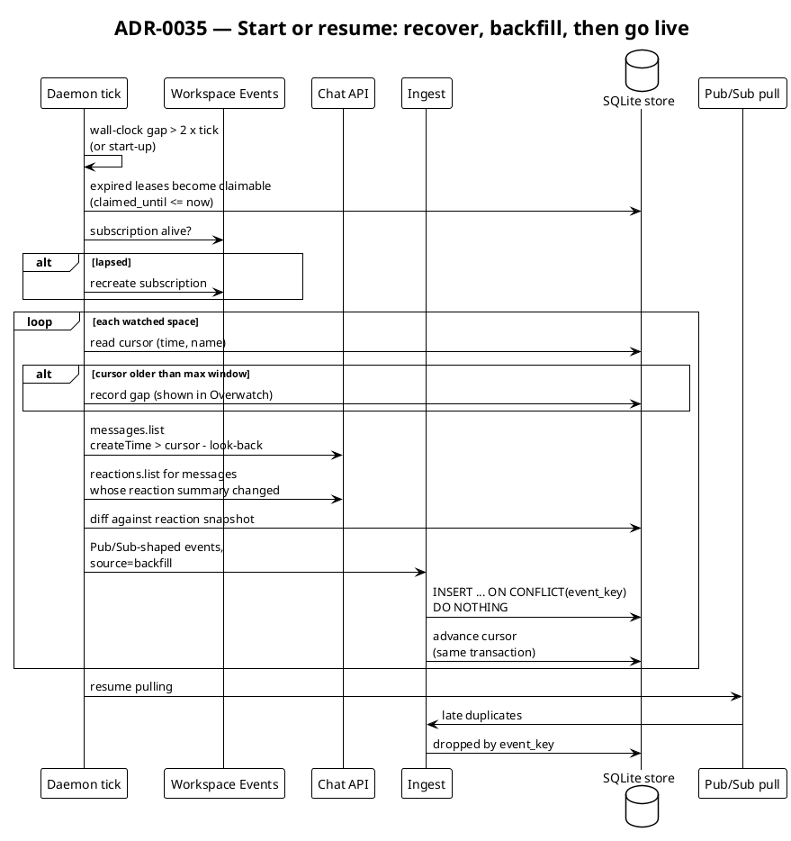

# 35. Local Google Chat bus: a user daemon with a SQLite lease queue

Date: 2026-11-06

## Status

Accepted (2026-11-06). The maintainer decided the hosting model (a
local daemon) and the authorization model (owner signal or approval
DM, with the allowlist in `gchat-config.yaml`) before acceptance.

Amends: [ADR-0011](0011-file-atomicity-and-locking-model.md) for
SQLite stores (D4).

Related: GH-1787 (milestone "COMM: Drive local bots from Google
Chat"), GH-1682 (armed Chat watches), GH-1612 (bus routing by
domain), GH-1617 (herdr worktree hand-off), ADR-0011 (file
atomicity), ADR-0029 (chat policy modules), ADR-0034 / GH-1567
(communication plugin extraction).

## Context

An authorized person should be able to drive the engineer's local
Claude sessions from Google Chat. They can ask a question, flag a
message or request new work. A local session then picks the request
up, answers in the thread or starts implementing. Every event and
command must be visible on the Overwatch page and controllable from
it.

### Current State

- `dev10x.comm.skills.notifications.gchat_watch` (GH-1682) polls
  armed threads through `gog` and advances a strict
  `(createTime, name)` cursor stored in `gchat-watch.json`.
- `dev10x.comm.skills.bus.routing` (GH-1612) routes an inbound
  message to a session that already exists and announced its domain.
- Overwatch shows sessions and their pending questions. It does not
  show inbound Chat events.
- A field-tested reference design exists in another team's setup. It
  uses a Chat app HTTP endpoint, a Workspace Events subscription for
  reactions pushed through Pub/Sub, a SQLite queue with a
  `claimed_until` lease, a small list/claim/reply/ack CLI, owner-only
  reaction triggers and an approval DM for privileged work. It is
  hosted on a cloud worker.

### Problems

1. Nothing turns an inbound message, a new thread or an emoji reaction
   into work for a session that does not exist yet.
2. Events live only in transient poll output. A restart, a suspend or
   two sessions racing on one message lose work or duplicate it.
3. The strict high-water cursor misses a message that is indexed
   late, because its `createTime` is already behind the cursor.
4. A Workspace Events subscription that carries resource data expires
   after at most 4 hours, or 24 hours with domain-wide delegation.
   One without resource data lasts up to 7 days
   ([event data](https://developers.google.com/workspace/events/guides#event-data)).
   The daemon carries resource data without delegation, so 4 hours
   applies.
   A machine that sleeps longer loses every event published while the
   subscription was lapsed.
5. The supervisor cannot see or triage what the bots were asked to do.

## Decision

We will run a **local user daemon**, `dev10x-chatbus`, on the
engineer's machine. It ingests Chat events into a local SQLite store.
It authorizes them against an owner allowlist in its own code, never
in the model. It exposes a lease-based work queue that sessions claim
through MCP tools, and it hands approved privileged work to herdr.

### Architecture



### D1. Hosting: a local daemon that pulls

The daemon runs as a systemd **user** unit on the engineer's machine.
It must reach local sessions, herdr, the maildir bus and Overwatch,
none of which a cloud worker can reach.

Reactions and messages arrive with no public endpoint:

- A Workspace Events subscription on `//chat.googleapis.com/spaces/-`
  for `reaction.created` and `reaction.deleted`, with
  `includeResource`, publishes to a Pub/Sub topic. The daemon reads it
  through a Pub/Sub **pull** subscription, so events queue in Pub/Sub
  while the machine sleeps. The daemon renews the subscription every
  hour and recreates it when it has lapsed.
- Google also delivers **batch** events (`reaction.v1.batchCreated`,
  `reaction.v1.batchDeleted`) to any subscription for the single type,
  carrying a `reactions` list, when many reactions land in a short
  period.
  Whether they reach the `spaces/-` target is as unconfirmed as the
  single events (next bullet).
  The source expands each into single-type events (D5) and acks the
  message once every space it touches has committed; a bad member is
  skipped and counted, not silently lost
  ([GH-1948](https://github.com/Dev10x-Guru/Dev10x-Claude/issues/1948)).
- Google documents reaction events only for subscriptions to one
  space.
  Whether the `spaces/-` target delivers them is unconfirmed; see the
  risk table.
- Messages and new threads come from a poll source over the watched
  spaces, DMs and threads. It subsumes the GH-1682 watcher as one
  ingest source.
- A Chat app HTTP endpoint for instant in-thread acknowledgement is
  out of scope. It would need public hosting.

### D2. Authorization: owner signal or approval DM

The daemon checks every event's sender against the allowlist before
it creates a command. The model never decides who may act.

| Sender | Event | Result |
|---|---|---|
| anyone | @mention or DM to the bot | a `reply` work item: the session may only answer in that thread |
| not allowlisted | reaction or command | stored as an event, recorded as a rejected command, no work item |
| `trusted` | privileged command (start a session, implement X) | a work item in `awaiting_approval`; the bot sends the owner an approval DM |
| `owner` | privileged reaction (🎫 / 🤖) or command | a queued privileged work item |
| `owner` | approval in the DM (✅ reaction or `approve <id>`) | the awaiting item becomes queued |

A dispatched agent gets only the tools for its one action. Replies
post as the bot identity, never as the user. Backfilled and replayed
events pass through the same check; a replay never bypasses it.

### D3. Allowlist storage: `bus_role` on `gchat-config.yaml` users

The allowlist extends the existing `users:` section of
`gchat-config.yaml` instead of adding a file:

```yaml
users:
  <github-login>:
    chat_user_id: "1234567890"
    name: Display Name
    bus_role: owner      # owner | trusted; absent = no authority
```

- An entry without `bus_role` has no authority. A bad value fails
  closed.
- Exactly one `owner` is required. The daemon refuses to start with
  zero or more than one.
- The daemon logs the effective allowlist at start and on `SIGHUP`
  reload, and Overwatch displays it. An edit made for notifications
  that changes authorization is therefore visible.
- Nothing arriving over Chat can write this file.

### D4. Store: one SQLite file in WAL mode

The store is `Dev10xConfigDir.home() / "chat-bus" / "bus.sqlite3"`,
reached through a new `Dev10xConfigDir.chat_bus_db()` accessor.
`DEV10X_CONFIG_HOME` relocates it for tests.

| Table | Purpose |
|---|---|
| `events` | every ingested event: `event_key` UNIQUE, `type`, `space`, `resource_name`, `sender`, `event_time`, `received_at`, `source` (`pubsub` / `poll` / `backfill`), `via_lookback`, `payload` (JSON) |
| `commands` | the authorization verdict for an event: `event_id`, `actor`, `verb`, `authorized`, `reason`, `created_at` |
| `work_items` | the queue: `event_id`, `kind` (`reply` / `privileged`), `status` (`queued` / `awaiting_approval` / `claimed` / `done` / `rejected`), `claimed_by`, `claimed_until`, `attempts`, `result`, `created_at`, `updated_at`; one item per (`event_id`, `kind`) |
| `cursors` | per space: `last_event_time`, `last_resource_name`, `updated_at` |
| `reaction_snapshot` | reactions the daemon has seen, used to infer deletions |
| `gaps` | windows the daemon could not recover, shown in Overwatch |
| `subscriptions` | the Workspace Events subscription the daemon renews: `target`, `name`, `expire_time`, `renewed_at` (GH-1840) |

`PRAGMA user_version` carries the schema version. Migrations run at
open time, in order, inside one transaction.

**Concurrency.** The daemon and the MCP tools both write. SQLite owns
the locking: WAL mode, a `busy_timeout`, and every write is one short
`BEGIN IMMEDIATE` transaction. This ADR amends ADR-0011 for SQLite
stores: they rely on SQLite's own locking instead of a
`dev10x.domain.file_locks` sidecar, because a sidecar would be a second
lock that SQLite does not know about. The store refuses to open when
WAL mode does not take effect, rather than run two writers without it.

**Access.** The store holds untrusted message text. Its directory is
created `0700` and the database `0600`; SQLite gives the `-wal` and
`-shm` files the database file's mode.

**Lease.** A claim is one statement:

```sql
UPDATE work_items
   SET status = 'claimed', claimed_by = :who,
       claimed_until = :until, attempts = attempts + 1,
       updated_at = :now
 WHERE id = (SELECT id FROM work_items
              WHERE status = 'queued'
                 OR (status = 'claimed' AND claimed_until <= :now)
              ORDER BY id LIMIT 1)
RETURNING id, event_id, kind, status, claimed_by, claimed_until,
          attempts, result;
```

An ack sets `done`, records the session's `result` and keeps the row,
so Overwatch can show the history. Only the session named in
`claimed_by` can ack or release an item. The reference design deletes acked rows; we keep them and
prune by age. A lapsed lease makes the item claimable again, so a
claim held by a session that died with a restart is never stuck.

### D5. Ingest is idempotent and source-blind

- `event_key` is the event type plus the message or reaction resource
  name. Ingest is `INSERT ... ON CONFLICT(event_key) DO NOTHING`, so
  the same event arriving from backfill and from a late Pub/Sub
  delivery lands once.
- Every source produces the Pub/Sub shape: the same `type` values
  (`google.workspace.chat.message.v1.created`,
  `google.workspace.chat.reaction.v1.created`,
  `google.workspace.chat.reaction.v1.deleted`) and the same
  `includeResource` payload.
  A batch event is stored as its member events, never under a batch
  type (GH-1948).
  `source` exists for diagnostics only.
  No consumer branches on it.
- A cursor advances in the same transaction that commits its event
  rows, never before.

### D6. Look-back window with a seen-set

Every poll and every backfill re-reads `look_back` minutes behind the
cursor (default 5, configurable). The `event_key` UNIQUE constraint is
the seen-set. When a sequential reader (poll or backfill) inserts an
event at or behind the stored cursor, only the look-back re-read could
have found it, so the row is stored with `via_lookback = 1` and
indexing lag can be measured rather than assumed. A late Pub/Sub
delivery behind the cursor is not look-back recovery and is not
flagged.

### D7. Restart and sleep backfill



1. **Detection.** Catch-up runs at start-up and whenever a tick sees a
   wall-clock gap larger than twice the tick interval. System sleep
   hooks need root, so the gap check is the primary signal. The
   logind `PrepareForSleep(false)` D-Bus signal is an optional faster
   trigger.
2. **Lease recovery** runs first. It needs no work, because the claim
   query already treats an expired lease as claimable.
3. **Subscription recovery** comes next: the daemon recreates a lapsed
   Workspace Events subscription before backfilling, so nothing falls
   between "backfill finished" and "pull resumed".
4. **Backfill** reads, for each watched space, the messages created
   since `cursor - look_back`. It lists reactions only on messages
   whose reaction summary differs from the snapshot, plus a bounded
   set of tracked recent messages. The snapshot diff synthesizes
   `reaction.created` and `reaction.deleted`. A reaction added and
   removed during the downtime appears in neither the snapshot nor
   the listing, so no event is created.
5. **Gaps.** A cursor older than the maximum backfill window, or a
   run cut short by the read budget, records a `gaps` row. Overwatch
   reports it instead of dropping it silently.

### D8. Polling budget and maximum window

Google publishes per-project and per-user read quotas for the Chat
API. The daemon's own caps sit well below them:

| Limit | Default |
|---|---|
| live poll tick | 60 s, one `messages.list` per watched space |
| watched spaces | 20 |
| page size | 100 |
| reads per backfill run | 1000; the remainder continues on the next tick, with a `gaps` row until it does |
| tracked recent messages for reaction diffing | 200 |
| maximum backfill window | 7 days, matching the default Pub/Sub message retention; a subscription can retain up to 31 days ([subscription properties](https://cloud.google.com/pubsub/docs/subscription-properties)) |

HTTP 408, 429 and the retryable 5xx responses back off through
`dev10x.domain.retry`, per ADR-0029.

### D9. How the daemon runs

- The unit file is `~/.config/systemd/user/dev10x-chatbus.service`,
  with `Type=simple`, `ExecStart=dev10x chatbus run` and
  `Restart=on-failure`, enabled with `systemctl --user enable --now`.
- Credentials come from the existing Google auth used by `gog` and the
  Chat bot (`gchat-config.yaml` `auth:`). The unit carries no secrets
  and does not set `PassEnvironment`. Diagnostics never print the
  user manager's environment; they read single named variables.
- `dev10x chatbus status` reports subscription expiry, cursor ages,
  queue depth and open gaps.

### D10. Hand-off to herdr

The dispatcher claims approved `privileged` items. It routes an item
to an existing session through `dev10x.comm.skills.bus.routing` when a
session's Role or Domain matches. Otherwise it asks herdr to create a
worktree workspace and an agent, briefed through a file, which is the
GH-1617 path. The brief is the message text marked as untrusted input,
plus the thread to answer in. The agent replies with information or a
link to the PR it opened. `reply` items are not dispatched. Any session
claims them through the `chat_queue_*` MCP tools.

### D11. Package placement

New code lives in a new subpackage, `src/dev10x/comm/chatbus/`. It
does not touch `src/dev10x/comm/overwatch/`; the Overwatch queue view
gets its own ticket. When GH-1567 (ADR-0034 Stage B, plugin B4) extracts
the communication plugin, `chatbus` moves as one unit with the rest of
`comm`. The only edit outside it is the `chat_bus_db()` accessor in
`dev10x.domain.dev10x_paths`, which stays in core with the other path
accessors.

### New Components

| Component | Location | Responsibility | Phase |
|---|---|---|---|
| `open_store` / `migrate` / `write_transaction` | `src/dev10x/comm/chatbus/store.py` | Open the database, migrate the schema, run short write transactions | 1 (GH-1838) |
| `ChatEvent` | `src/dev10x/comm/chatbus/events.py` | The Pub/Sub event shape every source produces | 1 (GH-1838) |
| `ingest_events` | `src/dev10x/comm/chatbus/ingest.py` | Insert each event exactly once and advance the cursor in the same transaction | 1 (GH-1838) |
| `enqueue` / `claim` / `ack` / `release` | `src/dev10x/comm/chatbus/queue.py` | Lease-based work queue | 1 (GH-1838) |
| `Authorizer` (planned) | `src/dev10x/comm/chatbus/authz.py` | Map sender, event and `bus_role` to a command verdict | 2 (GH-1839) |
| Pub/Sub and poll sources | `src/dev10x/comm/chatbus/sources/` | Produce Pub/Sub-shaped events | 3 (GH-1840) |
| `catch_up` / `backfill_space` | `src/dev10x/comm/chatbus/backfill.py` | Recover events missed during downtime and record `gaps` | 4 (GH-1841) |
| `remember_reactions` | `src/dev10x/comm/chatbus/snapshot.py` | Keep `reaction_snapshot` current from every source, so backfill can infer deletions | 4 (GH-1841) |
| `ChatRest` | `src/dev10x/comm/chatbus/sources/google_http.py` | Chat API history reads (messages since a time, reactions on a message) | 4 (GH-1841) |
| `chat_queue_*` tools (planned) | `src/dev10x/comm/mcp/` | list / claim / reply / ack for sessions | 5 (GH-1842) |
| `Dispatcher` (planned) | `src/dev10x/comm/chatbus/dispatch.py` | Hand approved privileged items to bus routing or herdr | 6 (GH-1843) |

### Dependencies (Reused Components)

| Component | Location | How We Use It |
|---|---|---|
| `Dev10xConfigDir` | `src/dev10x/core/domain/dev10x_paths.py` | Store location |
| `gchat_watch` parsing | `src/dev10x/comm/skills/notifications/gchat_watch.py` | Message parsing; the watcher becomes a poll source |
| bus routing | `src/dev10x/comm/skills/bus/routing.py` | Route to an existing session |
| `domain.retry` | `src/dev10x/core/domain/retry.py` | Back-off on 429 and 5xx |
| `Result` / `to_wire` | `dev10x.domain.common.result` | MCP boundary (ADR-0009) |

## Alternatives Considered

### Alternative 1: Cloud worker with a Chat app HTTP endpoint

The reference design's hosting: a public endpoint receives
Google-signed requests and pushed Pub/Sub events.

**Pros:** instant in-thread acknowledgement; no gap while the machine
sleeps.

**Cons:** it cannot reach local sessions, herdr, the maildir bus or
Overwatch without a tunnel back to the machine. It needs public
hosting and a second store to keep in sync, and the queue then lives
away from the sessions that work it.

**Verdict:** Rejected. The work happens on the local machine, so the
queue lives there too.

### Alternative 2: Pub/Sub pull only, without backfill

**Pros:** less code.

**Cons:** the Workspace Events subscription lapses after at most 4
hours (with resource data, no domain-wide delegation), and nothing is
published while it is lapsed.
An overnight sleep loses events silently.

**Verdict:** Rejected.

### Alternative 3: Approval DM for every privileged action

**Pros:** one uniform path that is easy to audit.

**Cons:** the owner pays a round trip even for work they started
themselves.

**Verdict:** Rejected in favor of D2. The owner's own reaction is
the approval.

### Alternative 4: Allowlist in its own file, or in the SQLite store

**Pros:** a separate file keeps authorization apart from notification
settings. A table is easy to edit from Overwatch.

**Cons:** a separate file is one more file for the same user records.
A table puts authorization next to data that untrusted events write.

**Verdict:** Rejected. The maintainer chose `gchat-config.yaml`, and
D3's fail-closed rules and visibility mitigate the coupling.

### Alternative 5 (Selected): Local daemon, Pub/Sub pull plus polling and backfill, SQLite lease queue

**Verdict:** Selected. See the Decision.

## Consequences

### What Becomes Easier

1. A message, thread or reaction becomes durable, deduplicated work
   that any session can claim.
2. A restart, a suspend or a crashed session no longer loses or
   strands work.
3. The supervisor sees every inbound request, its authorization
   verdict and its status in one place.

### What Becomes More Difficult

1. The engineer runs one more user service and one more Google Cloud
   resource (a Pub/Sub topic and subscription).
2. A notification config edit can change authorization. D3 makes such
   a change visible, but it cannot prevent it.
3. Two writers share one SQLite file, so every write path must stay a
   short transaction.

### Risks and Mitigations

| Risk | Likelihood | Impact | Mitigation |
|---|---|---|---|
| Prompt injection through a Chat message | High | High | The model never authorizes. A `reply` item gets only the reply tool, and the brief marks message text as untrusted |
| Sleep longer than the backfill window | Medium | Medium | A `gaps` row is shown in Overwatch |
| Chat API quota exhaustion | Low | Medium | D8 caps plus `domain.retry` back-off |
| Reaction deletions missed outside the tracked set | Medium | Low | The tracked-message cap is configurable; deletions only cancel triggers |
| Writer contention | Low | Low | WAL, `busy_timeout`, short `BEGIN IMMEDIATE` transactions |
| The `spaces/-` subscription delivers no reaction events (unconfirmed by Google's docs) | Medium | High | Verify on first live run; fall back to one subscription per watched space, within D8's space cap |
| A batch member is malformed | Low | Medium | The rest of the batch is stored; the member is logged and counted in `PullReport.skipped_members_by_type`. A batch with no usable member is dropped and counted in `dropped_by_type` instead ([GH-1948](https://github.com/Dev10x-Guru/Dev10x-Claude/issues/1948)) |

## Implementation Plan

The milestone "COMM: Drive local bots from Google Chat" holds one
issue per phase, chained with `Depends on:`.

| Phase | Issue | Depends on |
|---|---|---|
| 1. Store and lease queue: schema, migrations, idempotent ingest with `source=backfill`, cursors, claim / ack / release. Needs no Google setup | [GH-1838](https://github.com/Dev10x-Guru/Dev10x-Claude/issues/1838) | none |
| 2. Authorization: `bus_role`, the D2 verdict table, approval DM | [GH-1839](https://github.com/Dev10x-Guru/Dev10x-Claude/issues/1839) | GH-1838 |
| 3. Ingest sources: poll (subsuming GH-1682) and Pub/Sub pull | [GH-1840](https://github.com/Dev10x-Guru/Dev10x-Claude/issues/1840) | GH-1839 |
| 4. Restart and sleep backfill | [GH-1841](https://github.com/Dev10x-Guru/Dev10x-Claude/issues/1841) | GH-1840 |
| 5. `chat_queue_*` MCP tools | [GH-1842](https://github.com/Dev10x-Guru/Dev10x-Claude/issues/1842) | GH-1839 |
| 6. herdr dispatch | [GH-1843](https://github.com/Dev10x-Guru/Dev10x-Claude/issues/1843) | GH-1842 |
| 7. Overwatch queue view | [GH-1844](https://github.com/Dev10x-Guru/Dev10x-Claude/issues/1844) | GH-1842 |
| 8. Daemon packaging: `dev10x chatbus` CLI and systemd user unit | [GH-1845](https://github.com/Dev10x-Guru/Dev10x-Claude/issues/1845) | GH-1841, GH-1843 |

## References

### External Documentation

- [Google Workspace Events API: subscribe to Chat events](https://developers.google.com/workspace/events/guides/events-chat)
- [Chat API `spaces.messages.list`](https://developers.google.com/workspace/chat/api/reference/rest/v1/spaces.messages/list)
- [Chat API `spaces.messages.reactions.list`](https://developers.google.com/workspace/chat/api/reference/rest/v1/spaces.messages.reactions/list)
- [Google Workspace Events API: event data and subscription expiry](https://developers.google.com/workspace/events/guides#event-data)
- [Pub/Sub pull subscriptions](https://cloud.google.com/pubsub/docs/pull)
- [Pub/Sub subscription properties: message retention](https://cloud.google.com/pubsub/docs/subscription-properties)
- [SQLite `RETURNING`](https://www.sqlite.org/lang_returning.html)

### Internal References

- [GH-1787](https://github.com/Dev10x-Guru/Dev10x-Claude/issues/1787)
- [ADR-0011](0011-file-atomicity-and-locking-model.md)
- [ADR-0029](0029-chat-providers-share-policy-modules-not-a-base-class.md)
- [ADR-0034](0034-staged-plugin-split-restructure-first.md)
