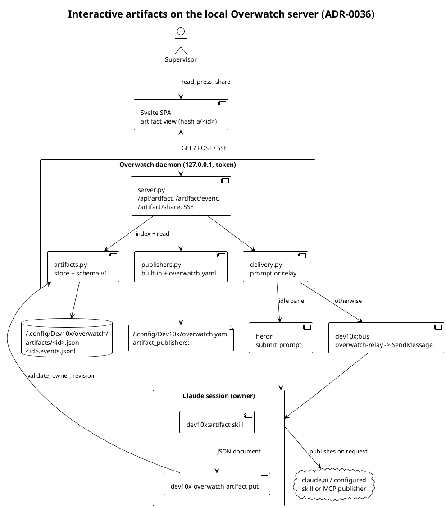
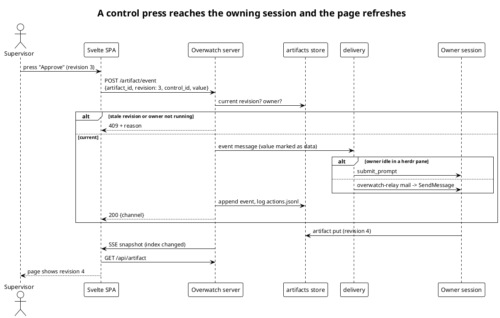

# 36. Interactive artifacts on the local Overwatch server

Date: 2026-11-14

## Status

Accepted (2026-11-14). The maintainer chose the content model, the
return channel, the fate of the claude.ai path and the pluggable
share menu before acceptance.

Related: GH-1938, ADR-0011 (file atomicity), ADR-0035 (local chat
bus), `dev10x:overwatch`, `dev10x:bus`, `dev10x:artifact`.

## Context

`dev10x:artifact` builds report and decision pages for the
supervisor. The supervisor reads them and then retypes each decision
into the session that asked, which defeats the point of a decision
page when several sessions run at once.

### Current State

- `dev10x:artifact` fills `skills/artifact/template.html` and
  publishes it with the claude.ai `Artifact` tool. The page is
  read-only and has no channel back to its session.
- Overwatch (`dev10x overwatch serve`) serves a Svelte 5 SPA on
  `127.0.0.1:8765` behind a per-boot token, streams snapshots over
  SSE, and already carries the supervisor's answers into sessions:
  `submit_prompt` into an idle herdr pane, or mail to the
  `overwatch-relay` bus mailbox that the relay session forwards with
  `SendMessage` (`delivery.py`).
- Sharing a page with the team means publishing it to claude.ai.
  A team that keeps documents in its own system has to publish by
  hand, and dev10x must not name that private system.

### Problems

1. Decisions on a page cannot reach the session that asked for them.
2. A page cannot change after a decision without a new publish.
3. Publishing is wired to one host; other hosts need a manual step.

## Decision

We will render artifacts as structured JSON documents on the local
Overwatch page, deliver control presses to the owning session over
the channels Overwatch already uses, keep claude.ai as an export
path, and make sharing a pluggable request that the owning session
carries out.

### Architecture

**D1 — Content model.** A session writes a `dev10x.artifact/v1`
document: views, each a list of typed blocks (`claim`, `prose`,
`kv`, `table`, `pills`, `stats`, `mermaid`, `draft`, `evidence`,
`callout`, `decisions`) and controls (`button`, `choice`, `form`).
Svelte components render each block as text. The page never renders
HTML the session wrote. The one markup insertion is a `mermaid`
block: mermaid, in `strict` security level, turns the session's
diagram source into SVG and the page inserts that SVG.

**D2 — Store.** Documents live in
`<overwatch state dir>/artifacts/<id>.json` (slug ids), written
under `dev10x.domain.file_locks` per ADR-0011. The store assigns a
monotonic `revision`; events append to `<id>.events.jsonl`.

**D3 — Owner.** `dev10x overwatch artifact put` records the session
that ran it, found by walking the ancestor process chain and
matching a PID in `claude agents --json`. A PoC in this session
matched the Bash parent PID to its own session entry. `--session`
overrides it.

**D4 — Return channel.** `POST /artifact/event` checks the revision
and the owner, then delivers one message that marks the value as data
from the supervisor: by prompt when the owner sits idle in a herdr
pane, otherwise through the relay. Both paths log to `actions.jsonl`.

**D5 — Live update.** The session answers by `put`ting a new
revision. The collector sees the artifact index change, bumps the
snapshot version, and the page refetches over SSE.

**D6 — Sharing.** The share menu lists the built-in `claude-ai`
publisher plus the user's `artifact_publishers:` entries in
`~/.config/Dev10x/overwatch.yaml` (kinds `skill`, `mcp`, `prompt`).
Choosing one sends the owning session a share request naming the
skill, MCP tool or prompt. Overwatch never calls a publisher, holds
no credentials and sends nothing off the machine. A private team
publisher exists only in that user file. The session records the
resulting link with `artifact shared`, and the page shows it.

**D7 — claude.ai stays.** `template.html` and the `Artifact` tool
path remain as the export used by the `claude-ai` publisher and for
pages meant for people outside the machine.

### Key Flows

#### Flow 1: A control press

### New Components

| Component | Location | Responsibility |
|-----------|----------|----------------|
| `artifacts` | `src/dev10x/comm/overwatch/artifacts.py` | Validate, store and index artifact documents and their events |
| `publishers` | `src/dev10x/comm/overwatch/publishers.py` | Merge the built-in publisher with the user's configured ones and word a share request |
| `owner` | `src/dev10x/comm/overwatch/owner.py` | Find the calling Claude session from the process chain |
| `artifact` CLI | `src/dev10x/commands/overwatch.py` | `put`, `url`, `list`, `shared` |
| Artifact view | `frontend/overwatch/src/components/artifact/` | Render blocks, controls and the share menu |

### Dependencies (Reused Components)

| Component | Location | How We Use It |
|-----------|----------|---------------|
| `deliver_to_session` (over `deliver_relay`, `log_action`) | `src/dev10x/comm/overwatch/delivery.py` | Deliver events and share requests by prompt or relay, and log them |
| SSE `_events`, token check | `src/dev10x/comm/overwatch/server.py` | Route guard, live refresh |
| `get_claude_sessions`, `submit_prompt` | `src/dev10x/comm/overwatch/probes.py` | Owner resolution; typing into an idle pane |
| `file_locks` | `src/dev10x/domain/file_locks.py` | Locked document writes, event appends |

## Alternatives Considered

### Alternative 1: Session HTML in a sandboxed iframe

Keep the HTML template; embed it in an iframe with a `postMessage`
bridge for controls.

**Pros:**
- Any layout the session can write
- No schema to maintain

**Cons:**
- Controls are untyped; the bridge must trust page script
- Theming and layout drift per page, the problem `dev10x:artifact`
  exists to prevent

**Verdict:** Rejected — the supervisor chose typed blocks.

### Alternative 2: Both blocks and an HTML escape hatch

**Pros:** covers odd layouts.
**Cons:** the largest scope and two security models.
**Verdict:** Rejected — deferred until a page needs it.

### Alternative 3: Bus-only or herdr-only delivery

**Pros:** one code path.
**Cons:** bus-only needs every session to arm a watcher; herdr-only
misses sessions started outside herdr.
**Verdict:** Rejected — reuse the two paths answers already take.

### Alternative 4: Overwatch calls publishers itself

**Pros:** sharing works with no session running.
**Cons:** the daemon would need MCP clients, credentials and
per-publisher code, and private publisher names would enter the repo.
**Verdict:** Rejected — the session already holds the tools.

### Alternative 5: Replace claude.ai entirely

**Pros:** one rendering path.
**Cons:** loses pages for readers outside the machine.
**Verdict:** Rejected — kept as the export path.

### Alternative 6: JSON documents on Overwatch, delivered by prompt or relay, publishers by request

**Verdict:** Selected.

## Consequences

### What Becomes Easier

1. A decision travels from page to session in one press.
2. A session updates the open page without a new link.
3. Any team adds its own publisher in a user file, with no dev10x
   change.

### What Becomes More Difficult

1. The block schema is a contract: changing it needs a schema version.
2. The committed static build grows by a lazily loaded mermaid chunk.
3. Controls work only while the owning session runs.

### Risks and Mitigations

| Risk | Likelihood | Impact | Mitigation |
|------|------------|--------|------------|
| Owner not found (no ancestor match) | Medium | Low | `--session` override, named in the error |
| Prompt typed into a busy pane | Low | Medium | Prompt only when the owner is idle with a pane (`deliver_to_session`); otherwise relay |
| Same control pressed on release and dev pages | Low | Low | Revision check; one event per revision and control |
| Page content used to inject instructions | Low | High | Text-only rendering; values sent as data; mermaid `strict` |

## Implementation Plan

### Phase 1: Store, owner, publishers, CLI

1. `artifacts.py`, `owner.py`, `publishers.py`, `paths.artifacts_dir`
2. `dev10x overwatch artifact put|url|list|shared`

### Phase 2: Server and delivery

1. Snapshot index and publishers, `GET /api/artifact`
2. `POST /artifact/event`, `POST /artifact/share`, delivery messages

### Phase 3: Page and skill

1. Svelte artifact view, block components, share menu; rebuild static
2. `dev10x:artifact` local flow, schema and publisher references

BPMN rendering stays on the export path in v1.

## References

### Internal References

- [ADR-0011 File atomicity and locking](0011-file-atomicity-and-locking-model.md)
- [ADR-0035 Local chat bus daemon](0035-local-chat-bus-daemon-with-sqlite-lease-queue.md)
- [GH-1938](https://github.com/Dev10x-Guru/Dev10x-Claude/issues/1938)
