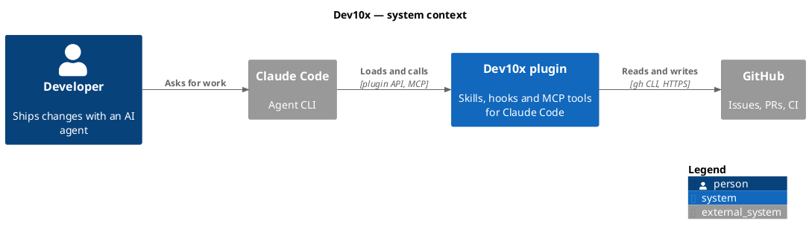
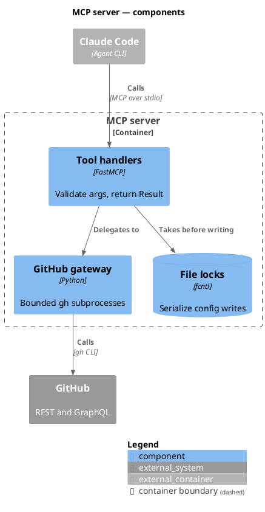

# C4-PlantUML Reference

Macros from the C4 stdlib bundled in `plantuml.jar`. Include exactly
one level per file, right after `@startuml` — each level includes the
ones above it.

| Level | Include | Answers |
|-------|---------|---------|
| 1 Context | `!include <C4/C4_Context>` | Who uses the system, and which other systems it talks to |
| 2 Container | `!include <C4/C4_Container>` | Which deployable/runnable units make up the system |
| 3 Component | `!include <C4/C4_Component>` | What is inside one container |
| Dynamic | `!include <C4/C4_Dynamic>` | Numbered interactions for one scenario |
| Deployment | `!include <C4/C4_Deployment>` | Which containers run on which infrastructure |

## Elements

| Macro | Use for |
|-------|---------|
| `Person(alias, "Label", "Description")` | A human role (`Person_Ext` outside the org) |
| `System(alias, "Label", "Description")` | The system in scope (level 1) |
| `System_Ext(...)` | Any system you do not own |
| `SystemDb(...)` / `SystemQueue(...)` | A whole system that is a store or a queue |
| `Container(alias, "Label", "Technology", "Description")` | An app, service, CLI, script set, SPA |
| `ContainerDb(...)` | **Any** data store: database, YAML/JSON files, bucket, cache |
| `ContainerQueue(...)` | Message queue, event bus, job queue |
| `Container_Ext(...)` | A container owned by someone else |
| `Component(alias, "Label", "Technology", "Description")` | A module/class group inside one container (level 3) |
| `ComponentDb(...)` | A repository/table group inside one container |
| `System_Boundary(alias, "Label") { ... }` | Draw the system in scope around its containers |
| `Container_Boundary(alias, "Label") { ... }` | Draw one container around its components |
| `Deployment_Node(alias, "Label", "Technology") { ... }` | Host, cluster, VM, region (deployment views) |

Containers carry the technology as the **third** argument — leaving it
out shifts the description into the technology slot.

## Relationships

| Macro | Use for |
|-------|---------|
| `Rel(from, to, "Label", "Technology")` | Default; layout picks the direction |
| `Rel_R` / `Rel_L` / `Rel_U` / `Rel_D` | Force a direction when the auto layout tangles |
| `BiRel(a, b, "Label")` | Genuinely symmetric exchange (rare — prefer two `Rel`s) |
| `Lay_R(a, b)` / `Lay_D(a, b)` | Invisible layout hint, no arrow |

Label every `Rel` with a verb phrase from the source's point of view
("Reads and writes", "Sends webhooks to"), and add the protocol as the
technology wherever it is known.

## Layout and legend

- `LAYOUT_LEFT_RIGHT()` — usually reads better than the default top-down
- `SHOW_LEGEND()` — last line before `@enduml`; always include it
- `title ...` — name the system and the level

## Example: level 1 context

## Example: level 3 component

## Example: deployment

```plantuml
@startuml dev10x-deployment
!include <C4/C4_Deployment>

title Dev10x — developer laptop

Deployment_Node(laptop, "Developer laptop", "Linux / macOS") {
    Deployment_Node(cc, "Claude Code", "Node.js") {
        Container(mcp, "MCP server", "Python, uv", "Long-lived tool server")
    }
    ContainerDb(cfg, "Config store", "YAML files", "&#126;/.config/Dev10x")
}

Rel(mcp, cfg, "Reads and writes")

SHOW_LEGEND()
@enduml
```

## Gotchas

| Symptom | Cause | Fix |
|---------|-------|-----|
| `~/.config` renders as `/.config` | `~` is PlantUML's creole escape character | Write `&#126;` (or `<U+007E>`); `~~` renders as two tildes |
| Description shows in the `[technology]` slot | `Container` called with three arguments | Pass `""` for an unknown technology |
| Two levels' boxes in one picture | Mixed `Container` and `Component` outside a boundary | One level per file; zoom in with a separate diagram |
| Arrows cross the whole diagram | Auto layout | Add `LAYOUT_LEFT_RIGHT()`, then `Rel_R`/`Lay_R` hints |
