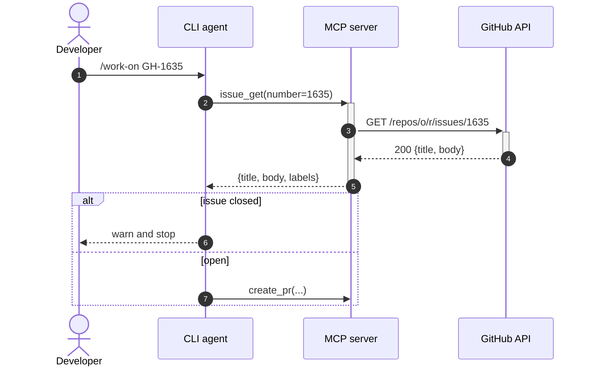

# Mermaid Sequence Syntax

Default notation for anything GitHub renders. Fence it as
` ```mermaid ` in Markdown; save it as `<flow>.mmd` when it also
needs a rendered image.

## Skeleton



## Participants

| Form | Use for |
|------|---------|
| `participant A as Label` | Services, processes, tools |
| `actor A as Label` | Humans |
| `box Aqua Group name` … `end` | Group participants (trust boundary, deployment unit) |
| `create participant W` before its first message | A participant that appears mid-flow |

Declare participants explicitly, in order — otherwise Mermaid orders
them by first mention, which rarely matches the reading order you want.

## Arrows

| Syntax | Meaning |
|--------|---------|
| `A->>B: msg` | Synchronous call |
| `B-->>A: msg` | Return / response |
| `A-)B: msg` | Asynchronous fire-and-forget |
| `A-xB: msg` | Failed / rejected call |
| `A->>+B` / `B-->>-A` | Open / close B's activation bar |

## Fragments

| Fragment | Use for |
|----------|---------|
| `alt cond` … `else other` … `end` | Branches |
| `opt cond` … `end` | Step that may not happen |
| `loop until X` … `end` | Retry / polling |
| `par A` … `and B` … `end` | Concurrent work |
| `break on error` … `end` | Early exit |
| `rect rgb(240,240,255)` … `end` | Highlight a region without semantics |

Every fragment closes with its own `end`.

## Notes and text

- `Note right of A: text`, `Note over A,B: text`
- Line break inside a label: `<br/>`
- A literal semicolon: `#59;` (a bare `;` ends the statement)
- Keep payloads short: `{pushed: true, sha}` beats the full JSON.
