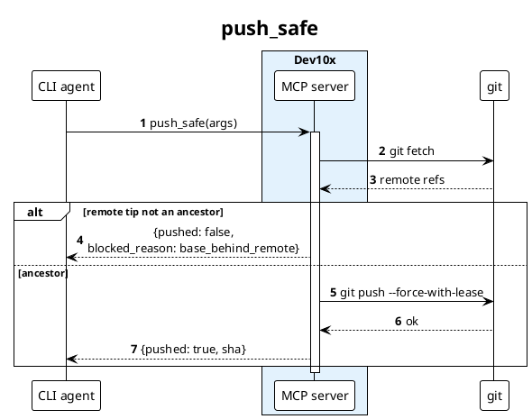

# PlantUML Sequence Syntax

Use when the destination needs a PNG/SVG file or finer layout than
Mermaid offers. Save as `<flow>.puml`; render with the skill's
`render.sh`.

## Skeleton

## Participants

`actor`, `participant`, `boundary`, `control`, `entity`, `database`,
`queue`, `collections` — each draws a different glyph. Group with
`box "Name" #Color` … `end box`.

## Arrows

| Syntax | Meaning |
|--------|---------|
| `A -> B : msg` | Synchronous call |
| `B --> A : msg` | Return |
| `A ->> B : msg` | Asynchronous |
| `A ->x B : msg` | Lost / rejected message |
| `A -[#red]> B : msg` | Colored arrow (use sparingly, for the error path) |

## Fragments

`alt`/`else`, `opt`, `loop`, `par`, `break`, `critical`, `group Label`
— each closes with `end`. **An unclosed fragment is not a syntax
error**: PlantUML closes it at `@enduml` and the frame silently
vanishes, so always read the rendered image.

## Layout helpers

- `activate X` / `deactivate X` — activation bars
- `== Phase name ==` — horizontal divider between phases
- `...` — elided time; `|||` — extra spacing
- `note over A, B` … `end note` — multi-line note
- `\n` — line break inside a label

Component, activity, and state patterns for ADRs stay in
`skills/adr/references/plantuml-patterns.md`.
